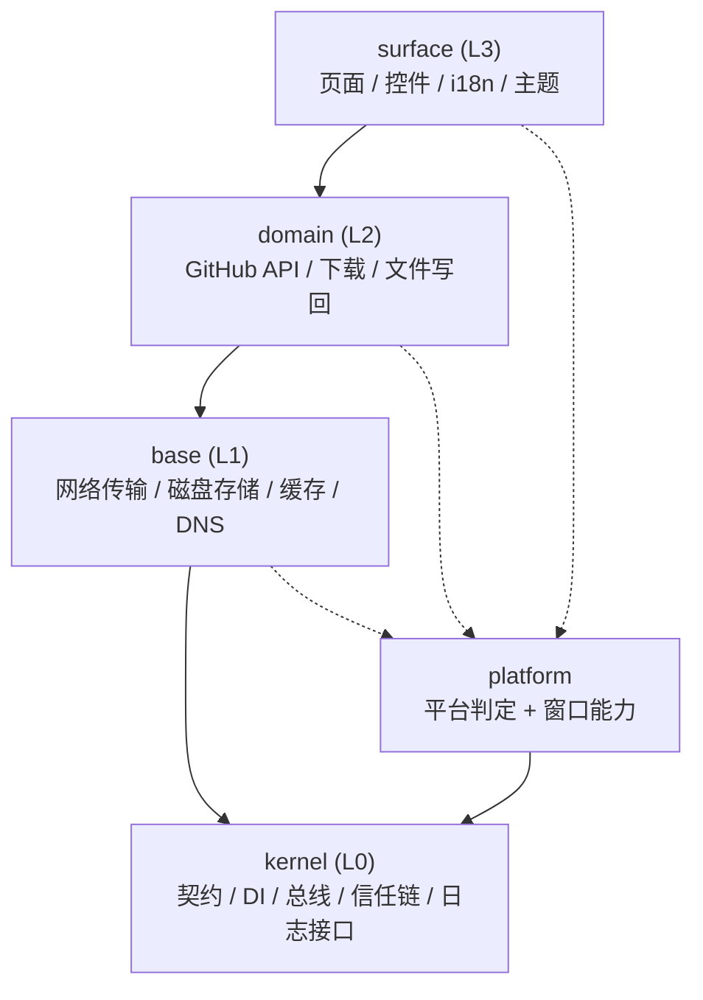

# OGL 架构

> **文档级别**：架构说明（Architectural Description）
> **适用读者**：贡献者、代码审阅者、构建发布工程师
> **维护要求**：本文所引用的符号必须与代码一致且**真实存在**；符号改名或行为变更时，须同步更新本文，否则文档将失去准确性。

## 摘要

OGL 采用五层架构（kernel · platform · base · domain · surface）实现严格的依赖方向控制。**依赖只能向下**：高层模块（surface、domain、base）仅允许引用低层抽象与桥接口；反向依赖（下层导入上层）以及跨层直接导入其他层的实现，均由 CI 门禁 `tool/layer_audit.py --fatal` 拦截。架构目标是在单一代码库内同时承载 Android、Windows、Linux、Web 四个目标，且保证平台差异集中收敛。

## 1. 背景

OGL 是一款跨平台 GitHub 客户端，需在移动端与桌面端提供一致的功能集与可靠性保证。早期版本采用扁平目录结构，跨层引用频繁；维护过程中出现三类反复出现的问题：

1. 平台判定散落多处（`base`、`surface`、`domain` 各自调用 `defaultTargetPlatform`），导致 Web 端与原生端的行为漂移；
2. 网络与磁盘实现细节被上层直接引用，使底层替换成本上升；
3. UI 代码绕过 domain 直接拼装 HTTP 请求，绕过失败处理与重试逻辑。

为解决上述问题，OGL 在 v6 重构为分层架构，并引入 CI 门禁保证依赖方向。

## 2. 设计目标

1. **依赖单向**：高层不得依赖低层实现，仅可依赖抽象与桥接口；
2. **平台判定收敛**：所有 `defaultTargetPlatform` 等平台识别调用须经 `platform` 层门面；新增代码不得直接进行平台判定；
3. **跨层访问受控**：跨层类型共享须经桥 / 门面，禁止直接导入其他层的实现；
4. **CI 强校验**：分层违规应在合并前被门禁拦截，不得依赖人工评审。

## 3. 架构总览

### 3.1 分层视图



### 3.2 各层职责

| 层 | 目录 | 职责 | 代表符号 |
| --- | --- | --- | --- |
| kernel (L0) | [`lib/kernel/`](../lib/kernel) | 契约（`contract/` 下的抽象接口）+ DI + 模块总线 + 信任链（引导清单签名与完整性）+ 日志接口 | `KernelDi` · `KernelModuleBus` · `OgLModule` · `BootLoader` · `BootIntegrityVerifier` · `KernelLogSink` |
| platform | [`lib/platform/`](../lib/platform) | 平台识别与窗口能力（标题栏 / 最大化 / 权限网关 / 存储裁决的选型点） | `ogLDetectPlatform()` · `window_capability.dart` · `window_*.dart` |
| base (L1) | [`lib/base/`](../lib/base) | 网络传输（重试 / 主机冷却 / DoH 回落）、磁盘存储、缓存引擎（D1–D7 一致性）、DNS | `NetTransport` · `ResilientTransport` · `DnsService` · `RepositoryCache` · `OgLStorage` |
| domain (L2) | [`lib/domain/`](../lib/domain) | GitHub API 客户端、下载与预签名、仓库文件写回、设备信息等业务逻辑 | `GhApi` · `DomainBridge` · `IxPresign` · `SysInfoService` |
| surface (L3) | [`lib/surface/`](../lib/surface) | 页面、控件、i18n、主题、用户交互与其共用构件 | `SurfaceBridge` · 页面 `pages/*_page.dart` · 共用构件 `app/`（`AsyncController` / `AsyncView` · `OgLNotifier` · `PagedController`） |

## 4. 详细设计

### 4.1 依赖方向

依赖只能向下：`surface → domain → base → kernel`。`platform` 仅依赖 `kernel`，可被 `base` / `domain` / `surface` 依赖。

```bash
python3 tool/layer_audit.py --fatal     # 有违规即退出 1（CI 门禁）
```

### 4.2 合法例外（`layer_audit.py` 的 `ALLOW`）

1. **装配根**：`domain/domain_bridge.dart`、`surface/surface_bridge.dart` —— 各层的装配入口，其职责为将下层接入本层，允许导入下层桥；
2. **类型门面**：`surface/types.dart` —— 交互层唯一允许 re-export 逻辑层 DTO / 异常的位置；页面仅导入该门面，因此无法取得 domain 的服务类。

### 4.3 已知待收敛项（`KNOWN`）

逻辑层目前直接依赖硬件层的两个具体类型 —— `GhApi` → `RepositoryCache`、`GhClient` → `NetBridge`。正确做法是在 `kernel/contract/` 定义抽象、由硬件层实现、逻辑层仅依赖抽象。

平台判定现状：`defaultTargetPlatform` 的**约定出处**为 `lib/platform/platform.dart`（本文即该约定的说明），但项目中仍有若干处按平台分流（`base/disk/app_dirs.dart`、`surface/app/permissions.dart` / `system_notifier.dart`、`domain/sys/sys_info.dart`）；将其统一收敛到 platform 层属待办事项。**新增代码不得直接进行平台判定**，应经 platform 层门面。

## 5. 命名约定

| 类别 | 命名 | 例 |
| --- | --- | --- |
| 页面 | `*_page.dart` | `pages/repo_page.dart` · `pages/settings_page.dart` |
| 桥（本层装配入口） | `*bridge.dart` | `base/base_bridge.dart` · `domain/domain_bridge.dart` · `surface/surface_bridge.dart`（硬件层内还有 `disk/disk_bridge.dart` · `net/net_bridge.dart`） |
| 平台实现 | `*_io.dart`（原生）· `*_web.dart`（浏览器） | `base/disk/app_dirs_fs_io.dart` · `base/net/net_dns_platform_io.dart`（web 分支已随 Web 支持一并移除，现无 `*_web.dart`；重新引入时按此命名） |
| 服务 / 门面 | `*service.dart` · `*manager.dart` · `*api.dart` | `domain/gh/repo_file_service.dart` · `domain/gh/gh_api.dart`（`DownloadManagerPage` 是**页面**，不属此类） |
| 共用构件（展示层） | 按"一件事一个文件"放在 `surface/app/` | `async.dart`（载 / 空 / 错 / 软错）· `notifier.dart`（提示语气）· `paged_controller.dart`（分页 + 快照） |

## 6. 决策记录

### 6.1 为何采用五层划分

- **依赖方向可静态验证**：分层后反向引用与跨层引用均可由 `layer_audit.py` 静态扫描识别，比代码评审更可靠；
- **平台差异收敛**：平台判定集中在 `platform` 层，避免 Web / 原生端行为漂移；
- **替换成本可控**：底层（`base`、`kernel`）的实现细节不暴露给上层，未来替换网络栈或存储引擎时影响面受限；
- **测试隔离**：低层可独立于 Flutter SDK 运行 `dart analyze`，CI 验证周期更短。

### 6.2 为何平台层用条件 import

平台层使用 `*_io.dart`（原生）与 `*_web.dart`（浏览器）的条件 import 约定，是因为 Flutter 的 `defaultTargetPlatform` 与 `kIsWeb` 判定在编译期即可解析，**不付出运行时分发代价**，又避免在 `base` / `domain` / `surface` 散落 `if (kIsWeb)` 分支；此约定由 `layer_audit.py` 的命名规则强制，违反命名（如 `*_web_stub.dart`）将无法被识别。

### 6.3 为何把 Web 推到独立分支

Web 端在文件系统、权限网关、网络出口三方面与原生端差异显著，曾在主线长期累积条件分支与 `kIsWeb` 守卫。为避免污染主线的「数据可靠性」基线，Web 端以独立分支推进并按 `*_web.dart` 命名约定接入 platform 层；落地后已并回主线，但 web 专属实现仍以 `_web.dart` 命名隔离，便于审计与回归。

## 7. 后续工作

1. **完成 §4.3 的已知收敛项**：将 `GhApi` / `GhClient` 对 `base` 层具体类型的依赖迁移至 `kernel/contract/` 抽象；
2. **统一平台判定路径**：消除 `base` / `surface` / `domain` 中残留的 `defaultTargetPlatform` 调用，全部经 platform 层门面；
3. **桥接层 ABI 文档化**：为各 `*bridge.dart` 维护接口清单与版本号，纳入 CI 卡点。

## 8. 附录

### 8.1 术语表

| 术语 | 含义 |
| --- | --- |
| 桥（bridge） | 各层的装配入口，职责是将下层接入本层；命名后缀 `Bridge` |
| 门面（facade） | 跨层类型共享的转发模块；典型为 `surface/types.dart` |
| 信任链 | 启动期对内置引导清单进行 Ed25519 签名校验与模块完整性校验的机制 |
| 档位质量表 | 动效分级的依据层；详见 `tool/motion_audit.py` |
| D1–D7 一致性 | 缓存引擎的一致性等级定义，详见 `RepositoryCache` |

### 8.2 自检命令（提交前执行）

```bash
python3 tool/layer_audit.py --fatal                          # 分层：违规 0
python3 tool/i18n_scan.py --check                            # i18n：未本地化 0 + 分片键一致
python3 tool/motion_audit.py --fatal                         # 动效：必须走档位质量表
python3 tool/perf_audit.py --fatal                           # 反模式：0
dart analyze lib/kernel lib/base lib/domain lib/platform     # 四个不依赖 Flutter SDK 的层：0 问题
```

展示层（`lib/surface/`）需要真实 Flutter SDK 才能运行 `dart analyze`，在无 SDK 的环境中以 `dart format --output=none lib`（纯语法解析）兜底；四个非 UI 层的静态分析必须为 **0 问题**。

### 8.3 相关文档

- [`docs/README.md`](README.md) —— 文档目录索引
- [`docs/NETWORK.md`](NETWORK.md) —— 网络出口与传输层
- [`docs/I18N.md`](I18N.md) —— 多语言维护手册

## 9. 修订历史

| 版本 | 日期 | 修订摘要 |
| --- | --- | --- |
| v9.0.0 | 2026-10 | 重构为标准架构文档：增加摘要、设计目标、决策记录、后续工作、修订历史；架构图改为代码块定义 |
| v6.x | 2024 | 建立五层架构与 `layer_audit.py` 门禁 |
| v5.x | 2023 | 早期扁平结构；分层重构前的基线 |